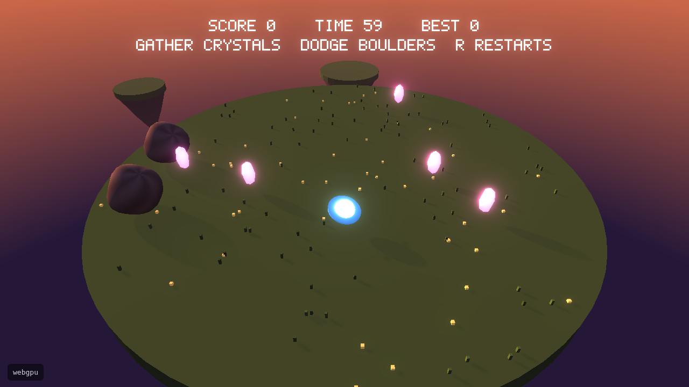

# orbfall

A game built on [DriftEngine](https://driftengine.dev): pilot a hovering orb across a floating
island at dusk, gather glowing crystals, and keep clear of the boulders rolling at you. A run lasts
60 seconds; a crystal is worth a point and a fall off the edge costs three.



## How it was made

A coding agent built it from one prompt, the one in [PROMPT.md](PROMPT.md), in about fourteen
minutes. It started from `npm create @driftengine@latest orbfall` and worked from what that writes:
the project's `AGENTS.md`, the engine's `driftengine` skill, and `npm run check`, which typechecks,
runs the rules' tests in Node, and photographs the game on WebGPU and on WebGL2. It ran the check
four times and none failed. [BUILD-LOG.md](BUILD-LOG.md) is its own log, every check and every time
it opened the pictures, and the commits from the request to the finished game are its own.

- **Keyboard**: WASD or the arrows to steer, R to restart, Space or Enter to play again.
- **Gamepad**: the left stick to steer, Start to restart, A to play again.
- **Touch**: a thumb on the left half steers, a tap on the right plays again.

```sh
npm install
npm run dev      # serve it with hot reload
npm run check    # typecheck, test, and look at it on WebGPU and WebGL2
npm run build    # static files in dist/
```

`src/main.ts` is the program and `src/*.drs` are its rules in DriftScript. `AGENTS.md` is written
for a coding agent working in this project, and the `driftengine` skill in `.agents/skills/` and
`.claude/skills/` teaches it the engine.

The [manual](https://driftengine.dev/docs) explains each system with code that runs, and the
[examples](https://github.com/drftrun/driftengine/tree/main/examples) are small programs, one
capability each.
